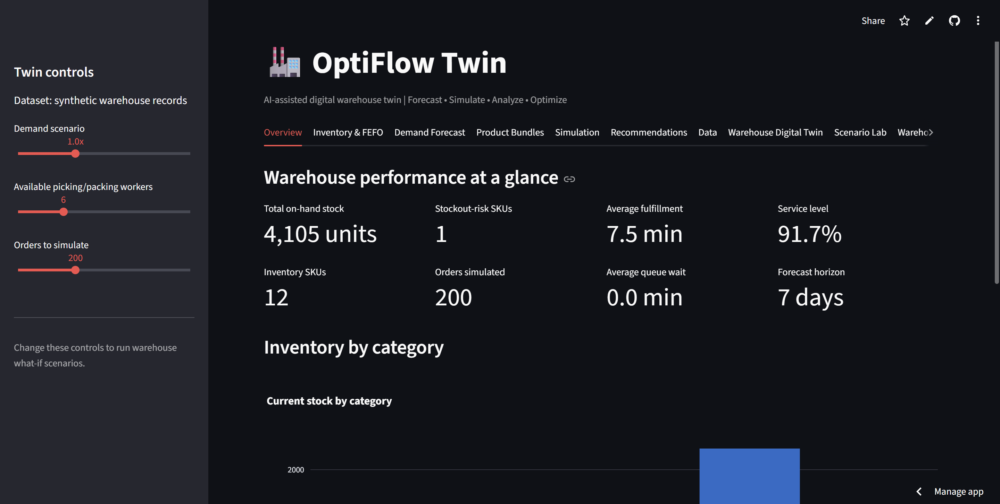
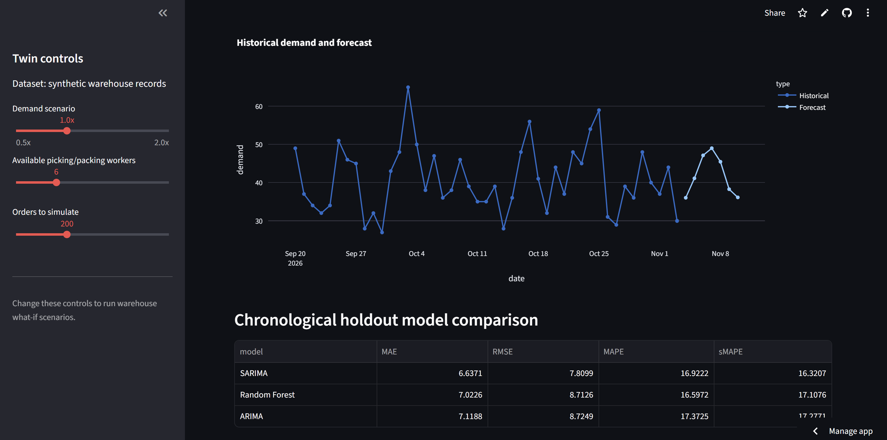
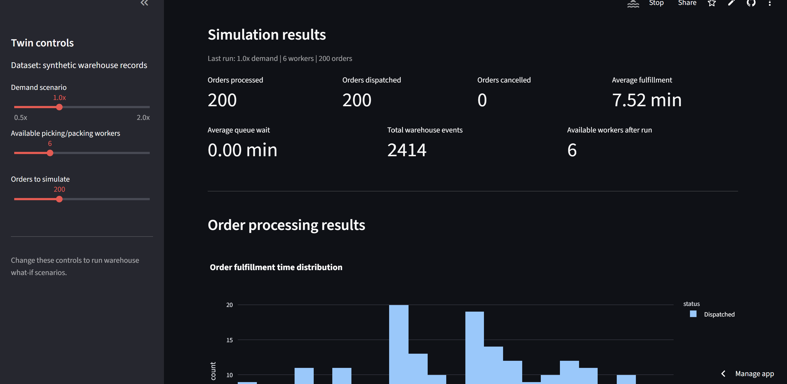
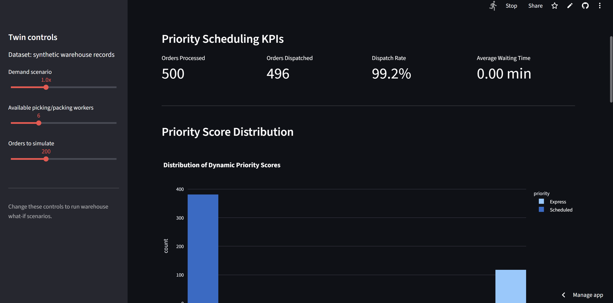

# OptiFlow Twin
### AI-Powered Digital Warehouse Management & Optimization Platform

<p align="center">
  <strong>Transforming warehouse operations through Artificial Intelligence, Digital Twin Simulation, and Intelligent Optimization.</strong>
</p>

<p align="center">
  <a href="https://optiflow-twin-nf2npvjbwyn2kmkywyxxwq.streamlit.app/">Live Demo</a> •
  <a href="https://github.com/SHRUNGAD11/OptiFlow-Twin">GitHub Repository</a>
</p>

---

## Overview

**OptiFlow Twin** is an AI-powered warehouse management and optimization platform that combines machine learning, inventory optimization, digital twin simulation, and intelligent order scheduling.

The platform models warehouse operations and helps analyze how demand fluctuations, inventory constraints, warehouse layouts, and workforce availability affect order fulfillment performance.

It provides an interactive Streamlit dashboard for exploring operational metrics, testing warehouse scenarios, and evaluating optimization strategies.

## Key Features

### 1. AI-Based Demand Forecasting
- Implements ARIMA, SARIMA, and Random Forest forecasting models.
- Uses chronological train-test evaluation.
- Evaluates models using MAE, RMSE, MAPE, and sMAPE.
- Generates seven-day SKU-level demand forecasts.

### 2. Intelligent Inventory Optimization
- Dynamic safety stock calculation.
- Lead-time-aware reorder point estimation.
- Economic Order Quantity (EOQ).
- FEFO (First Expired, First Out) inventory dispatch.
- Expiry monitoring and replenishment recommendations.

### 3. Warehouse Digital Twin
- Simulates warehouse inventory and order operations.
- Models worker availability and order fulfillment.
- Tracks operational events and warehouse performance.
- Evaluates warehouse behavior under different operating conditions.

### 4. Scenario Analysis
Supports five operational scenarios:

- Normal Demand
- High Demand
- Peak Demand
- Workforce Shortage
- Peak Demand with Workforce Shortage

### 5. Warehouse Layout Optimization
- Demand-based product slotting.
- ABC inventory classification.
- Manhattan-distance-based picking analysis.
- Comparison of alphabetical, demand-based, and ABC-based layouts.

**Observed result:** The demand-based and ABC-based layouts achieved a 2.83% reduction in weighted average picking distance compared with the alphabetical baseline on the current dataset.

### 6. Intelligent Order Prioritization
- Dynamic order scoring based on urgency, waiting time, and workload.
- Express and Scheduled order classification.
- Simulation-based scheduling.
- Priority score and waiting-time analysis.
- Static versus dynamic scheduler benchmarking.

**Observed result:** In the high-demand benchmark, dynamic scheduling reduced Scheduled-order average waiting time by approximately 7.05%, while increasing Express-order waiting time. This represents a scheduling trade-off rather than an overall throughput improvement.

## Application Screenshots

### Dashboard Overview


### Demand Forecasting


### Warehouse Digital Twin Simulation


### Intelligent Order Prioritization


## Technology Stack

| Category | Technologies |
|---|---|
| Programming Language | Python |
| Frontend & Dashboard | Streamlit |
| Data Processing | Pandas, NumPy |
| Machine Learning | Scikit-learn |
| Forecasting | ARIMA, SARIMA, Random Forest |
| Discrete-Event Simulation | SimPy |
| Data Visualization | Plotly |
| Testing | Pytest |
| Version Control | Git, GitHub |
| Deployment | Streamlit Community Cloud |

## System Architecture

The platform follows a modular architecture:

1. **Data Layer:** Warehouse inventory, historical sales, orders, and product information.
2. **Analytics Layer:** Demand forecasting, inventory analysis, and order prioritization.
3. **Optimization Layer:** Warehouse slotting, replenishment, and scheduling strategies.
4. **Simulation Layer:** Digital twin engine for modeling warehouse operations.
5. **Presentation Layer:** Interactive Streamlit dashboard.

## Project Structure

```text
OptiFlow-Twin/
│
├── app.py
├── requirements.txt
├── pytest.ini
├── README.md
│
├── data/
│   ├── inventory.csv
│   ├── orders.csv
│   ├── order_lines.csv
│   └── ...
│
├── src/
│   ├── forecasting.py
│   ├── inventory.py
│   ├── recommendations.py
│   ├── warehouse_state.py
│   ├── digital_twin_simulation.py
│   ├── scenario_analysis.py
│   ├── layout_optimizer.py
│   ├── order_prioritization.py
│   └── benchmark_schedulers.py
│
└── tests/
    ├── test_phase1.py
    ├── test_digital_twin.py
    └── test_order_prioritization.py
```

## Installation and Setup

### Prerequisites

- Python
- Git
- pip

### 1. Clone the repository

```bash
git clone https://github.com/SHRUNGAD11/OptiFlow-Twin.git
cd OptiFlow-Twin
```

### 2. Create a virtual environment

**Windows:**

```powershell
python -m venv .venv
.\.venv\Scripts\Activate.ps1
```

**macOS/Linux:**

```bash
python -m venv .venv
source .venv/bin/activate
```

### 3. Install dependencies

```bash
python -m pip install --upgrade pip
pip install -r requirements.txt
```

### 4. Run the application

```bash
streamlit run app.py
```

Open the local application at:

```text
http://localhost:8501
```

## Testing

Run the automated test suite:

```bash
pytest -v
```

**Current validation: 29 tests passed.**

The tests cover forecasting and inventory functionality, warehouse state management, simulation behavior, and order prioritization.

## Performance Evaluation

The following results were observed using the project's current dataset and simulation configuration.

| Evaluation | Observed Result |
|---|---:|
| Automated tests | 29 passed |
| Picking distance improvement | 2.83% |
| Scheduled-order waiting-time reduction under high demand | 7.05% |
| Forecasting models evaluated | 3 |
| Dashboard modules | 11 |

Results are dataset- and scenario-dependent. They should not be interpreted as guaranteed improvements in a live warehouse.

## Dataset and Assumptions

The project uses warehouse-related CSV datasets for inventory, historical sales, and order operations.

The order-line dataset includes synthetically generated records to support order-level simulation. Therefore, simulation and optimization results should be interpreted as prototype evaluations rather than validated outcomes from a production warehouse.

## Limitations

- The current implementation uses dataset-driven and simulated warehouse operations.
- The warehouse layout optimizer uses a heuristic slot-assignment approach.
- Dynamic scheduling does not preempt orders already being processed.
- Simulation results depend on the selected demand, workforce, and inventory assumptions.
- Production deployment would require integration with real warehouse management systems and live operational data.

## Future Enhancements

- Real-time warehouse sensor and IoT integration.
- Reinforcement learning for adaptive order scheduling.
- Advanced warehouse layout optimization algorithms.
- Live inventory synchronization with ERP/WMS systems.
- Multi-warehouse digital twin simulation.
- Predictive workforce allocation.
- Role-based authentication and operational access control.

## Live Application

Explore the deployed application:

**[Launch OptiFlow Twin](https://optiflow-twin-nf2npvjbwyn2kmkywyxxwq.streamlit.app/)**

## Author

**SHRUNGA D**

B.Tech – Computer Science and Engineering (2023-2027) 
M. S. Ramaiah University of Applied Sciences

[GitHub Profile](https://github.com/SHRUNGAD11)

---

<p align="center">
  <strong>OptiFlow Twin – Intelligent Warehousing Through AI and Digital Twin Technology.</strong>
</p>
